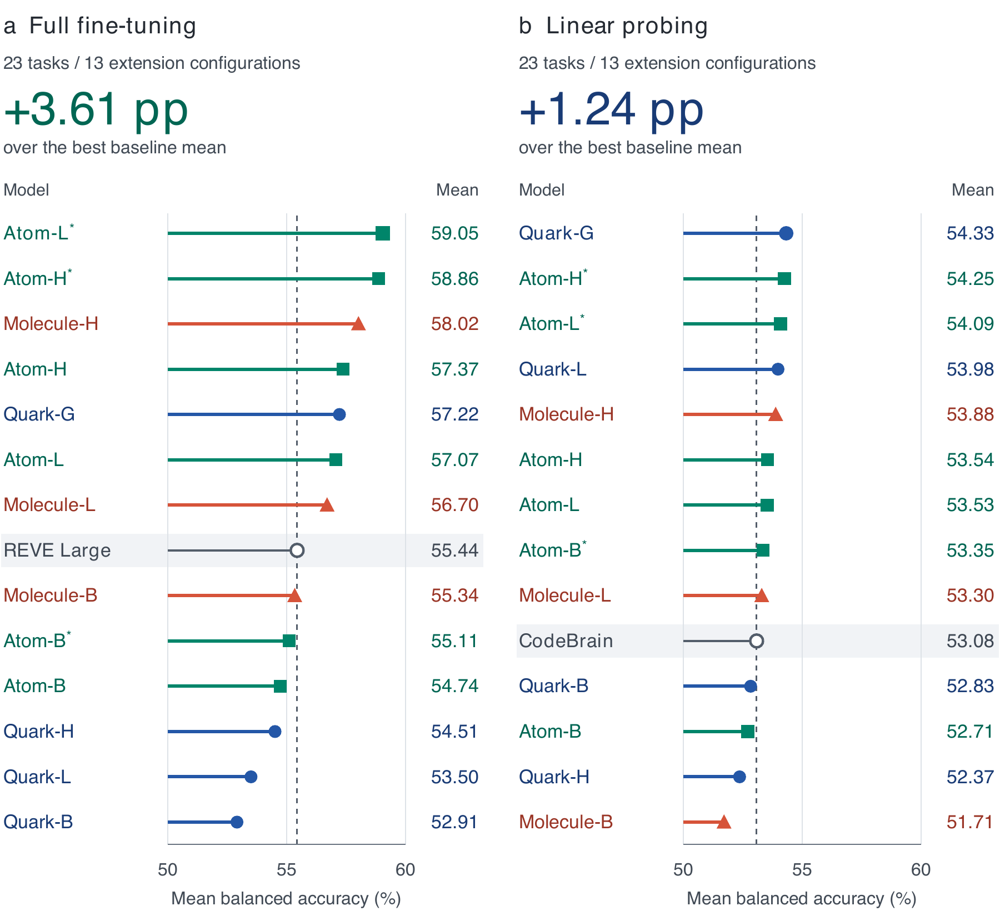

<div align="center">

# LaBraM at Scale

### Scaling Data and Models for EEG Pretraining

Jun-Yu Pan · Ruicheng Yin · Bao-Liang Lu · Dongsheng Li · Wei-Long Zheng · Yansen Wang

<p>
  <a href="https://github.com/AlbertMentat/LaBraM-at-Scale"></a>
  &nbsp;
  <a href="https://huggingface.co/Pan-Junyu/LaBraM-at-Scale"></a>
</p>

[Technical report](site/assets/report.pdf) · [Project page](https://albertmentat.github.io/LaBraM-at-Scale/) · [Installation](docs/INSTALLATION.md) · [Usage](docs/USAGE.md)

</div>

We scale LaBraM by increasing its pretraining data and encoder size. The release includes **10 encoders**, trained on **25,067–79,910 hours of EEG** and ranging from **5.8M to 1.97B parameters**. Evaluation covers full fine-tuning, linear probing and shared EEG–Qwen3 classification across **23 EEG tasks**.

<p align="center"></p>

- **Full-FT:** Atom-L\* reaches **59.05%**, exceeding REVE Large by **3.61 percentage points** with a 46.3M-parameter encoder.
- **Linear probing:** Quark-G reaches **54.33%**, exceeding CodeBrain by **1.24 percentage points**.
- **Shared EEG–Qwen3 classification:** Molecule-H + Qwen3-8B reaches **50.50 ± 2.17%** across the 23 tasks.
- Larger encoders improve Full-FT more consistently than LP. Data-fraction experiments suggest that the useful data scale depends on encoder capacity. Downstream performance can decline while pretraining loss continues to fall.

## Models and results

| Model | Encoder parameters | Pretraining hours | Full-FT (%) | LP (%) |
|:---|---:|---:|---:|---:|
| Quark-B | 5.8M | 25,067 | 52.91 | 52.83 |
| Quark-L | 46.3M | 25,067 | 53.50 | 53.98 |
| Quark-H | 369M | 25,067 | 54.51 | 52.37 |
| Quark-G | 1.97B | 25,067 | 57.22 | 54.33 |
| Atom-B | 5.8M | 49,628 | 54.74 | 52.71 |
| Atom-L | 46.3M | 49,628 | 57.07 | 53.53 |
| Atom-H | 369M | 49,628 | 57.37 | 53.54 |
| Molecule-B | 5.8M | 79,910 | 55.34 | 51.71 |
| Molecule-L | 46.3M | 79,910 | 56.70 | 53.30 |
| Molecule-H | 369M | 79,910 | 58.02 | 53.88 |
| Atom-B* | 5.8M | 49,628 | 55.11 | 53.35 |
| Atom-L* | 46.3M | 49,628 | 59.05 | 54.09 |
| Atom-H* | 369M | 49,628 | 58.86 | 54.25 |

Parameters refer to the EEG encoder; hours report the pretraining corpus duration. The [FT](site/assets/results_ft.csv) and [LP](site/assets/results_lp.csv) tables include every model and task, with [seed-level results](site/assets/results_per_task.csv) available separately.

<details>
<summary><strong>Evaluation and model selection</strong></summary>

Results are mean balanced accuracy across 23 tasks and seeds 42, 10 and 5, following OmniEEG-Bench. All downstream settings use at most **40 training windows per subject–class pair**; validation and test splits retain their full samples. Single-task hyperparameters are selected using seed42 test performance and reused for the other seeds. Within each fit, validation balanced accuracy selects the fine-tuned model. LP takes the higher available pooled or no-pool three-seed mean for each model and task; SleepEDF uses pooled features.

Unstarred results use the last evaluated full-data pretraining checkpoint. **Atom-B\*, Atom-L\* and Atom-H\*** use one checkpoint per encoder selected by the highest evaluated 23-task Full-FT mean, then apply that same checkpoint to FT and LP.

</details>

## Get started

Use Linux and Python 3.10. Install the appropriate PyTorch wheel for your hardware; this example uses CUDA 12.8:

```bash
git clone https://github.com/AlbertMentat/LaBraM-at-Scale.git
cd LaBraM-at-Scale
python3.10 -m venv .venv
source .venv/bin/activate
python -m pip install --upgrade pip
python -m pip install torch==2.8.0 torchvision==0.23.0 \
  --index-url https://download.pytorch.org/whl/cu128
python -m pip install -r requirements.txt
python -m pip check

python scripts/download_checkpoint.py --model molecule-base
```

The downloader verifies the weight SHA-256. Add `--variant best-full-ft` to obtain a model selected by its best evaluated Full-FT mean. Use `--tokenizer quark`, `--tokenizer atom` or `--tokenizer molecule` to download the matching original tokenizer. The [Hugging Face model card](https://huggingface.co/Pan-Junyu/LaBraM-at-Scale) describes both sets, containing ten weight files each.

### Fine-tune or probe

Prepare `<task>/{train,val,test}/*.pkl` and `<task>/label_map.json`. Each sample contains `X` as float32 `[channels, time]` at 200 Hz, an integer `y`, and `ch_names`.

```bash
MODE=ft FAMILY=79k MODEL=labram_base_patch200_200 NPROC=1 \
CHECKPOINT=checkpoints/molecule-base.safetensors DATA_DIR=/data/tasks/TUAB \
OUTPUT_DIR=outputs/tuab_ft LR=3e-4 LAYER_DECAY=0.75 SEED=42 \
bash scripts/run_eval.sh
```

Use `MODE=lp_pool` or `MODE=lp_nopool` for linear probing. Each fit saves the model or probe selected on validation data. Saved probes can be evaluated again with `evaluate_linear_probe.py`. `FAMILY=25k`, `49k` and `79k` select Quark, Atom and Molecule input normalization. Prepare the training splits with the report's 40-window subject–class cap before running evaluation. See [Usage](docs/USAGE.md) for architectures, defaults and the hyperparameter grids.

## Training and implementation

EEG recordings differ in channel layout and duration. We set window lengths by channel count and batch compatible layouts to control sequence length. Sharded data loading supplies distributed training, while FSDP reduces per-GPU memory use for larger encoders. LaBraM's encoder design and pretraining objective are retained.

| Workflow | Guide |
|:---|:---|
| Train a tokenizer or EEG encoder | [Training recipes](configs/recipes/) · [Pretraining pipelines](docs/USAGE.md#pretraining-pipelines) |
| Fine-tune or train a linear probe | [Downstream evaluation](docs/USAGE.md#downstream-evaluation) |
| Train a shared EEG–Qwen3 classifier | [Multitask guide](multitask/README.md) |
| Understand the implementation changes | [Implementation notes](docs/IMPLEMENTATION_VS_OFFICIAL_LABRAM.md) |
| Explore all benchmark results | [Project page](https://albertmentat.github.io/LaBraM-at-Scale/) · [Page maintenance](docs/PROJECT_PAGE.md) |

The loaders use prepared data. Pretraining datasets are listed in the [technical report](site/assets/report.pdf) and the [machine-readable inventory](data_manifests/pretraining/datasets.csv); obtain them from their source providers. [data_manifests/](data_manifests/) contains downstream split snapshots, sample indices and input requirements. Dataset-specific preprocessing and split construction, baseline implementations and task-specific adapters are maintained separately.

## Acknowledgements and licensing

This work builds on [LaBraM](https://github.com/935963004/LaBraM), introduced in [ICLR 2024](https://openreview.net/forum?id=QzTpTRVtrP). Its MIT copyright and license are preserved in [third_party/LaBraM-LICENSE.txt](third_party/LaBraM-LICENSE.txt). See [third-party notices](THIRD_PARTY_NOTICES.md) for attribution. Original code and EEG encoder/tokenizer weights use the [MIT License](LICENSE).
